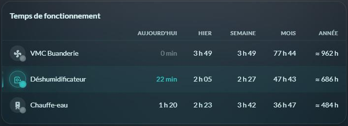
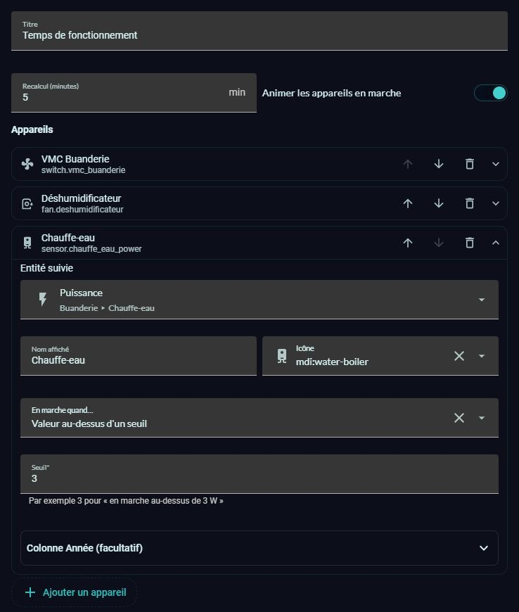

# ⏱️ HOLM Runtime Card

[](https://hacs.xyz/)


[🇫🇷 Français](README.md) · 🇬🇧 English

**How long does the ventilation, the water heater or the pool pump run? Today, yesterday, this week, this month, this year — without creating a single helper.**

HOLM Runtime Card computes the **running time** of your devices straight from the Home Assistant **history**. No `history_stats` sensor to create, no automation: list your devices, the card does the maths.

> ✨ **Zero YAML.** Everything is set in the card's visual editor.

### At a glance

- 📅 **5 periods**: Today, Yesterday, Week (since Monday), Month, Year.
- 🔌 **Any kind of entity**: switch (`on`), power sensor (running above a threshold), thermostat (chosen states, e.g. `heat`)…
- 📈 **Full year**: beyond the 30 days of history, the card can estimate the duration from the **long-term statistics** of a power sensor (value prefixed with “≈”).
- 🌀 **Animation while the device runs**: the badge “breathes”, the icon spins for fans, pumps, ventilation, washing machines…, the light pulses and a glowing bar marks the row. Running periods count up live.
- 👆 Tap a device to open its Home Assistant dialog.
- 🔄 Automatic refresh every 5 minutes (adjustable).
- 🌍 **8 languages**: English, French, German, Spanish, Italian, Dutch, Portuguese and Polish.



*Screenshots in French — the card follows the language of your Home Assistant profile.*

### 🆕 What's new in 1.2.0

- 🌍 **The card speaks 8 languages**: English, French, German, Spanish, Italian, Dutch, Portuguese and Polish. It follows the language of your Home Assistant profile (English if your language isn't translated yet), and the `language` option lets you force one.

### What's new in 1.1.0

- **Visual editor**: add, reorder and remove devices; for each one, the entity, name, icon, the “running” rule (by state or by threshold) and, optionally, the Year column.
- **Animation of running devices**, can be turned off, and automatically disabled when your system asks for reduced motion.
- The “running” state follows Home Assistant live.



---

## Installation

### With HACS (recommended)

1. HACS → ⋮ menu → **Custom repositories**.
2. Add `https://github.com/kaaribou/holm-runtime-card`, category **Dashboard** (*Plugin*).
3. Search for the card → **Download**.
4. Reload the page (Ctrl + F5).

### Manually

1. Copy `dist/holm-runtime-card.js` to `config/www/community/holm-runtime-card/`.
2. **Settings → Dashboards → ⋮ → Resources → Add**: `/local/community/holm-runtime-card/holm-runtime-card.js`, type **JavaScript module**.
3. Reload the page.

---

## Usage

Add the **HOLM – Runtime** card to a dashboard, then **Add a device** in the editor. For each device, choose when it is “running”:

- **By its state**: `on` by default, or a list such as `heat, cool` for a thermostat;
- **Value above a threshold**: for example a power sensor above 3 W;
- **Value below a threshold**.

The optional **Year column** section accepts a power sensor with statistics to estimate the year beyond the kept history.

The YAML equivalent:

```yaml
type: custom:holm-runtime-card
title: Runtime
devices:
  - name: Ventilation
    entity: switch.ventilation
    icon: mdi:fan
  - name: Water heater
    entity: sensor.water_heater_power
    above: 3                     # running above 3 W
    power_entity: sensor.water_heater_power   # for the full year
  - name: Heat pump
    entity: climate.heat_pump
    on_states: [heat, cool]
```

## Options

| Option | Description | Default |
|---|---|---|
| `title` | Title (empty to hide it) | `Runtime` (in the card's language) |
| `devices` | List of devices | — |
| `refresh_minutes` | Refresh interval | `5` |
| `animation` | Animate running devices | `true` |
| `language` | Card language: `fr`, `en`, `de`, `es`, `it`, `nl`, `pt`, `pl` | the profile's |

Each device accepts:

| Key | Description |
|---|---|
| `entity` | Tracked entity (**required**) |
| `name`, `icon` | Displayed name and icon (defaults to the entity's) |
| `on_state` / `on_states` | State(s) considered “running” (default `on`) |
| `above` / `below` | For a numeric value: running above / below the threshold |
| `power_entity` | Power sensor with statistics, to estimate the year beyond the history |
| `on_power` | Running power (W); automatic if missing |
| `idle_power` | Idle power (W), default 0 |

## Good to know

- Home Assistant keeps detailed history for **10 days by default** (`recorder: purge_keep_days`). Beyond that, a value followed by “*” means the history is incomplete for the period.
- Without `power_entity`, the Year column only counts the part covered by the history (“*”).
- The icon spins when it depicts a rotating device (fan, ventilation, pump, washing machine, dryer, dishwasher, robot vacuum…); the others “breathe”.

## FAQ

| Problem | Solution |
|---|---|
| Month or Year marked “*” | Increase the recorder's `purge_keep_days`, or add a `power_entity` for the yearly estimate. |
| I don't want the animation | Untick **Animate running devices** (`animation: false`). |
| The card is not in my language | Set `language` in the card, or open an issue to suggest a translation. |
| The new version doesn't show | Clear the cache (Ctrl + F5). |

---

## Say thanks?

Like the card? You can buy me a beer 🍺

[](https://paypal.me/kaaribou)

---

## License

Code: **MIT** license — © kaaribou. See the [CHANGELOG](CHANGELOG.md) (in French).

Part of **HOLM — Home Orchestration & Living Management**: smart management and orchestration of the home.

Other projects: [Volets HOLM](https://github.com/kaaribou/volets-holm) · [Climat HOLM](https://github.com/kaaribou/climat-holm) · [Carburant HOLM](https://github.com/kaaribou/carburant-holm) · [HOLM LaMetric](https://github.com/kaaribou/lametric-holm) · [HOLM My Menu](https://github.com/kaaribou/holm-mymenu) · [HOLM Lektrico](https://github.com/kaaribou/lektrico-holm) · [HOLM Navbar Card](https://github.com/kaaribou/holm-navbar-card) · [HOLM Climate Card](https://github.com/kaaribou/climate-card-holm) · [HOLM Music Card](https://github.com/kaaribou/holm-music-card) · [HOLM Sentinel Card](https://github.com/kaaribou/holm-sentinel-card) · [HOLM Security Card](https://github.com/kaaribou/holm-security-card) · [HOLM Recordings Card](https://github.com/kaaribou/holm-recordings-card) · [HOLM Covers Card](https://github.com/kaaribou/holm-covers-card) · [HOLM Power Flow Card](https://github.com/kaaribou/holm-power-flow-card) · [HOLM Energy Cards](https://github.com/kaaribou/holm-energy-cards) · [HOLM Radiator Card](https://github.com/kaaribou/holm-radiator-card) · [HOLM Floor Card](https://github.com/kaaribou/holm-floor-card) · [HOLM Ecojoko Card](https://github.com/kaaribou/holm-ecojoko-card) · [HOLM Smoke Card](https://github.com/kaaribou/holm-smoke-card).
