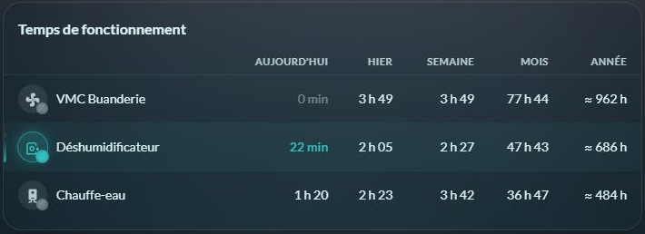
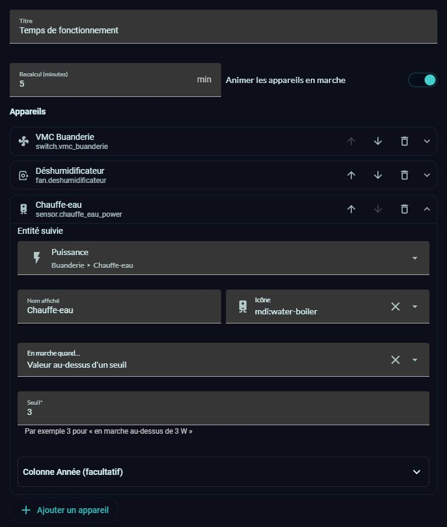

# ⏱️ HOLM Runtime Card

[](https://hacs.xyz/)


**Combien de temps tourne la VMC, le chauffe-eau ou la pompe de la piscine ? Aujourd'hui, hier, cette semaine, ce mois, cette année — sans créer un seul helper.**

HOLM Runtime Card calcule le **temps de fonctionnement** de vos appareils directement à partir de l'**historique** de Home Assistant. Pas de capteur `history_stats` à créer, pas d'automatisation : on liste les appareils, la carte fait les calculs.

> ✨ **Zéro YAML.** Tout se règle dans l'éditeur visuel de la carte.

### En bref

- 📅 **5 périodes** : Aujourd'hui, Hier, Semaine (depuis lundi), Mois, Année.
- 🔌 **Tout type d'entité** : interrupteur (`on`), capteur de puissance (en marche au-dessus d'un seuil), thermostat (états choisis, ex. `heat`)…
- 📈 **Année complète** : au-delà des 30 jours d'historique, la carte peut estimer la durée à partir des **statistiques long terme** d'un capteur de puissance (valeur précédée de « ≈ »).
- 🌀 **Animation quand l'appareil tourne** : la pastille « respire », l'icône tourne pour les ventilateurs, pompes, VMC, lave-linge…, le voyant pulse et une barre lumineuse marque la ligne. Les durées en cours avancent en direct.
- 👆 Un toucher sur un appareil ouvre sa fiche Home Assistant.
- 🔄 Recalcul automatique toutes les 5 minutes (réglable).



### 🆕 Nouveautés de la 1.1.0

- **Éditeur visuel** : ajoutez, réordonnez et supprimez vos appareils ; pour chacun, l'entité, le nom, l'icône, la règle « en marche » (selon l'état ou selon un seuil) et, en option, la colonne Année.
- **Animation des appareils en marche**, désactivable, et coupée automatiquement si votre système demande moins d'animations.
- L'état « en marche » suit Home Assistant en direct.



---

## Installation

### Avec HACS (recommandé)

1. HACS → menu ⋮ → **Dépôts personnalisés**.
2. Ajoutez `https://github.com/kaaribou/holm-runtime-card`, catégorie **Tableau de bord** (*Dashboard / Plugin*).
3. Recherchez la carte → **Télécharger**.
4. Rechargez la page (Ctrl + F5).

### Manuellement

1. Copiez `dist/holm-runtime-card.js` dans `config/www/community/holm-runtime-card/`.
2. **Paramètres → Tableaux de bord → ⋮ → Ressources → Ajouter** : `/local/community/holm-runtime-card/holm-runtime-card.js`, type **Module JavaScript**.
3. Rechargez la page.

---

## Utilisation

Ajoutez la carte **HOLM – Temps de fonctionnement** à un tableau de bord, puis **Ajouter un appareil** dans l'éditeur. Pour chaque appareil, choisissez quand il est « en marche » :

- **Selon son état** : `on` par défaut, ou une liste comme `heat, cool` pour un thermostat ;
- **Valeur au-dessus d'un seuil** : par exemple un capteur de puissance au-dessus de 3 W ;
- **Valeur en dessous d'un seuil**.

La section **Colonne Année** (facultative) accepte un capteur de puissance avec statistiques pour estimer l'année au-delà de l'historique conservé.

L'équivalent en YAML :

```yaml
type: custom:holm-runtime-card
title: Temps de fonctionnement
devices:
  - name: VMC
    entity: switch.vmc
    icon: mdi:fan
  - name: Chauffe-eau
    entity: sensor.chauffe_eau_puissance
    above: 3                     # en marche au-dessus de 3 W
    power_entity: sensor.chauffe_eau_puissance   # pour l'année complète
  - name: Pompe à chaleur
    entity: climate.pompe_a_chaleur
    on_states: [heat, cool]
```

## Options

| Option | Description | Par défaut |
|---|---|---|
| `title` | Titre (vide pour le masquer) | `Temps de fonctionnement` |
| `devices` | Liste des appareils | — |
| `refresh_minutes` | Intervalle de recalcul | `5` |
| `animation` | Animer les appareils en marche | `true` |

Chaque appareil accepte :

| Clé | Description |
|---|---|
| `entity` | Entité suivie (**obligatoire**) |
| `name`, `icon` | Nom et icône affichés (par défaut ceux de l'entité) |
| `on_state` / `on_states` | État(s) considéré(s) comme « en marche » (défaut `on`) |
| `above` / `below` | Pour une valeur numérique : en marche au-dessus / en dessous du seuil |
| `power_entity` | Capteur de puissance avec statistiques, pour estimer l'année au-delà de l'historique |
| `on_power` | Puissance en marche (W) ; automatique si absent |
| `idle_power` | Consommation à l'arrêt (W), défaut 0 |

## Bon à savoir

- Home Assistant conserve l'historique détaillé **10 jours par défaut** (réglage `recorder: purge_keep_days`). Au-delà, une valeur suivie de « * » signale un historique incomplet sur la période.
- Sans `power_entity`, la colonne Année ne compte que la partie couverte par l'historique (« * »).
- L'icône tourne quand elle évoque un appareil rotatif (ventilateur, VMC, pompe, lave-linge, sèche-linge, lave-vaisselle, aspirateur robot…) ; les autres « respirent ».

## FAQ

| Problème | Solution |
|---|---|
| Mois ou Année marqués « * » | Augmentez `purge_keep_days` du recorder, ou ajoutez un `power_entity` pour l'estimation annuelle. |
| Je ne veux pas d'animation | Décochez **Animer les appareils en marche** (`animation: false`). |
| La nouvelle version ne s'affiche pas | Videz le cache (Ctrl + F5). |

---

## Un petit merci ?

La carte vous plaît ? Vous pouvez m'offrir une bière 🍺

[](https://paypal.me/kaaribou)

---

## Licence

Code : licence **MIT** — © kaaribou. Voir le [CHANGELOG](CHANGELOG.md).

Fait partie de **HOLM — Home Orchestration & Living Management** : la gestion et l'orchestration intelligente de la maison.

Les autres projets : [Volets HOLM](https://github.com/kaaribou/volets-holm) · [Climat HOLM](https://github.com/kaaribou/climat-holm) · [Carburant HOLM](https://github.com/kaaribou/carburant-holm) · [Commandes à la maison HOLM](https://github.com/kaaribou/commandes-holm) · [HOLM LaMetric](https://github.com/kaaribou/lametric-holm) · [HOLM My Menu](https://github.com/kaaribou/holm-mymenu) · [HOLM Lektrico](https://github.com/kaaribou/lektrico-holm) · [HOLM Navbar Card](https://github.com/kaaribou/holm-navbar-card) · [HOLM Climate Card](https://github.com/kaaribou/climate-card-holm) · [HOLM Music Card](https://github.com/kaaribou/holm-music-card) · [HOLM Sentinel Card](https://github.com/kaaribou/holm-sentinel-card) · [HOLM Security Card](https://github.com/kaaribou/holm-security-card) · [HOLM Recordings Card](https://github.com/kaaribou/holm-recordings-card) · [HOLM Covers Card](https://github.com/kaaribou/holm-covers-card) · [HOLM Power Flow Card](https://github.com/kaaribou/holm-power-flow-card) · [HOLM Energy Cards](https://github.com/kaaribou/holm-energy-cards) · [HOLM Radiator Card](https://github.com/kaaribou/holm-radiator-card) · [HOLM Floor Card](https://github.com/kaaribou/holm-floor-card) · [HOLM Ecojoko Card](https://github.com/kaaribou/holm-ecojoko-card) · [HOLM Smoke Card](https://github.com/kaaribou/holm-smoke-card) · [HOLM BG Card](https://github.com/kaaribou/holm-bg-card).
